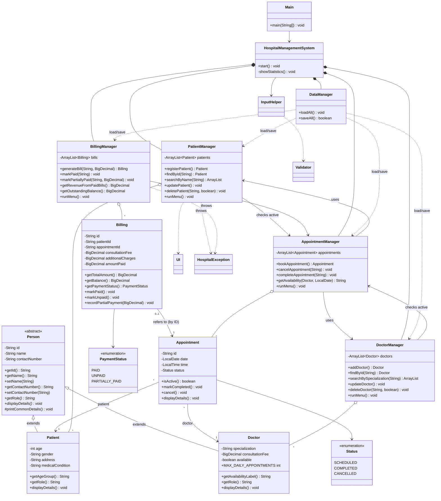

# UML Class Diagram

**Legend:** `<|--` inheritance, `o--` aggregation (manager holds an ArrayList of objects), `*--` composition (the system creates and owns its managers), `-->` association/uses, `..>` dependency. Helper classes `UI`, `Validator`, `InputHelper` and `HospitalException` are used throughout; only a few links are drawn to keep the diagram readable.
